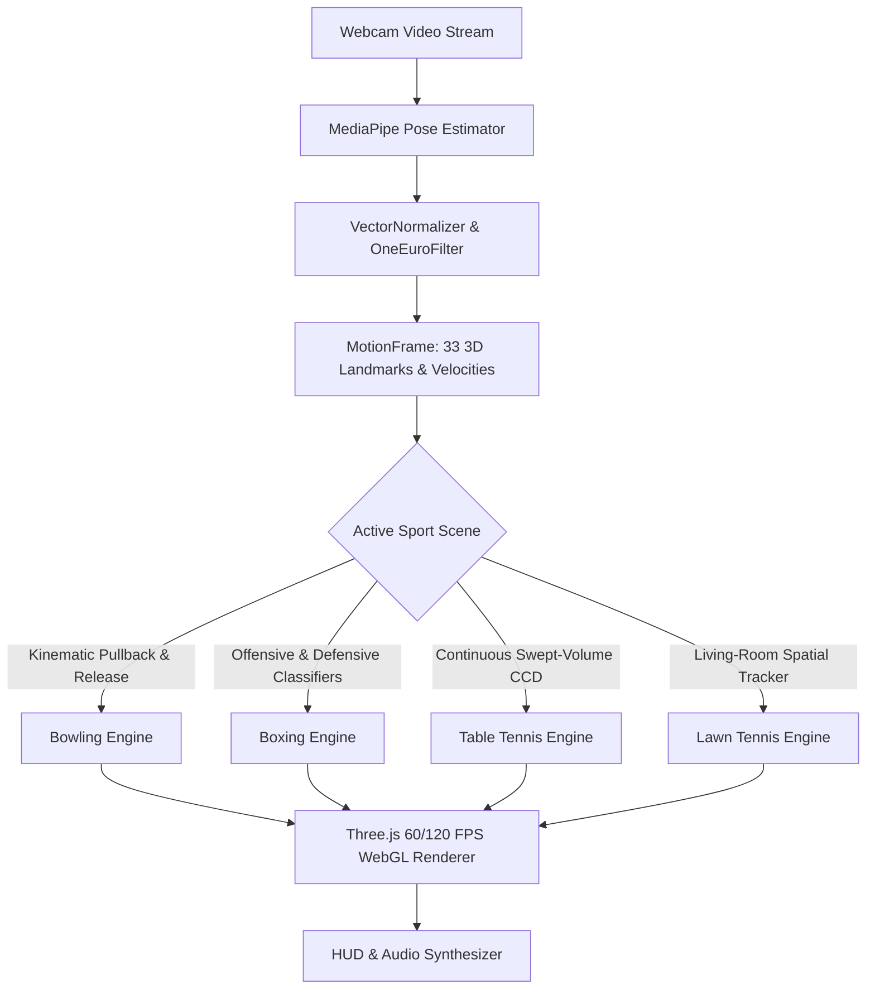

# CamArena Motion Sports Wiki

Welcome to the **CamArena Knowledge Base & Technical Wiki**. CamArena is an athletic 3D motion-tracking sports platform developed using **Three.js, MediaPipe Pose, TypeScript, and the Web Audio API**. It transforms standard 2D webcams into full-motion, markerless athletic gaming controllers for both casual living rooms and competitive arcade gameplay.

This wiki provides comprehensive documentation on the sports rules, biomechanical tracking models, physics simulation, AI algorithms, camera systems, and game architectures for the featured sports.

---

## 📚 Sports Wiki Directory

| Sport | Engine Module | Mode ID | Input Paradigms | Primary Ruleset |
|---|---|---|---|---|
| [**Bowling**](file:///docs/wiki/bowling.md) | `src/bowling/BowlingScene.ts` | `'bowling'` | Seated / Standing Upper-Body Gesture | USBC 10-Pin Regulation |
| [**Boxing**](file:///docs/wiki/boxing.md) | `src/boxing/BoxingScene.ts` | `'boxing'` | Standing Biomechanical Combat Rig | Marquess of Queensberry Arcade |
| [**Table Tennis**](file:///docs/wiki/table_tennis.md) | `src/tabletennis/TableTennisScene.ts` | `'tabletennis'` | 1:1 Dominant Wrist CCD Tracking | ITTF Official Table Tennis |
| [**Lawn Tennis**](file:///docs/wiki/lawn_tennis.md) | `src/tennis/TennisScene.ts` | `'tennis'` | Living-Room Spatial Footwork & Swing | ITF Regulation Singles |

---

## 🏗️ Core Architecture Overview

CamArena is built on a modular game scene engine managed through `GameSceneManager` and standardized around the `IGameScene` interface:

### Shared Engine Pillars:
1. **Markerless Vision Pipeline**:
   - Uses MediaPipe Pose (33 full-body landmarks, 3D world coordinates).
   - High-rate temporal smoothing through `OneEuroFilter` (minimizing jitter at rest while eliminating lag during fast ball strikes or punches).
   - Kinetic dead-reckoning via `OcclusionPredictor` when limbs exit camera FOV.
2. **Deterministic Dual Input**:
   - Primary: Live webcam full-body or upper-body motion tracking.
   - Fallback / Hybrid: High-precision mouse cursor 3D strike-plane raycasting and keyboard movement for accessibility and desktop testing.
3. **Procedural Web Audio Engine (`SoundSynthesizer`)**:
   - Zero external audio sample downloads. All sound effects—including 10-pin shattering, leather boxing glove impacts, ping-pong paddle ticks, tennis ball compressions, crowd murmurs, and referee bells—are procedurally generated in real time using Web Audio API oscillators, bandpass filters, and noise bursts.

---

## 📖 Deep Dives & Detailed Guides

Explore each sport's dedicated technical wiki page:
- 🎳 [**Bowling 3D Pro Wiki**](file:///docs/wiki/bowling.md): Complete guide to 10-pin scoring, seated pose kinematics, two-phase delivery state machine, hook curve physics, and pin-cam juice.
- 🥊 [**Boxing 3D Pro Wiki**](file:///docs/wiki/boxing.md): Complete guide to punch classification (Jabs, Crosses, Hooks, Uppercuts), defensive maneuvers (High Guard, Body Guard, Slips, Ducks), AI opponent "Iron Titan", and hit reaction rigs.
- 🏓 [**Table Tennis 3D Pro Wiki**](file:///docs/wiki/table_tennis.md): Complete guide to ITTF 11-point match rules, swept-volume line-segment continuous collision detection (CCD), topspin/backspin Magnus mechanics, and serve rules.
- 🎾 [**Lawn Tennis 3D Pro Wiki**](file:///docs/wiki/lawn_tennis.md): Complete guide to ITF singles rules, 120 Hz fixed sub-tick aerodynamics, adaptive living-room footwork mapping, and tactical rally pacing AI.

