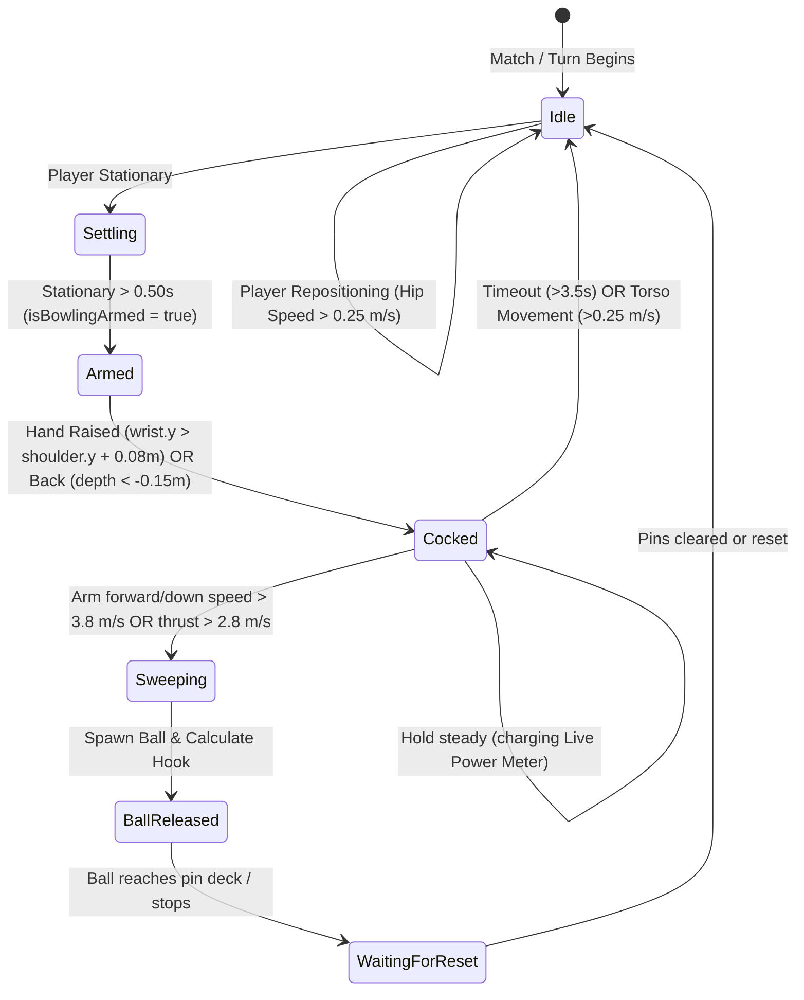
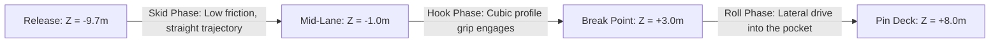

# Arcade Bowling 3D Pro Wiki

**Module Path**: [`src/bowling/BowlingScene.ts`](file:///src/bowling/BowlingScene.ts)  
**Game Mode ID**: `'bowling'`  
**Governing Standard**: United States Bowling Congress (USBC) 10-Pin Bowling with Arcade Enhancements  

---

## 1. Executive Summary & Sport Overview

**Arcade Bowling 3D Pro** brings authentic 10-pin bowling into the digital realm using markerless webcam computer vision. It is engineered to operate seamlessly in both **seated living-room environments** and **full standing arcade stances**, utilizing upper-body kinematic tracking to translate real arm arm swings and wrist angles into realistic ball release velocities, hook trajectories, and pin-deck impact physics.

### USBC 10-Pin Bowling Fundamentals:
- A regulation game consists of **10 frames**.
- In frames 1 through 9, the bowler gets up to **two deliveries** to knock down all 10 pins.
- **Strike ($\mathbf{X}$)**: All 10 pins knocked down on the first delivery. Earns 10 points plus the pinfall of the next two deliveries.
- **Spare ($\mathbf{/}$)**: All remaining pins cleared on the second delivery. Earns 10 points plus the pinfall of the very next delivery.
- **Open Frame**: Fewer than 10 pins knocked down across two rolls; scores simply the number of pins felled.
- **10th Frame Bonus**: If a bowler strikes in the 10th frame, they receive two additional bonus rolls; a spare earns one bonus roll (maximum 3 rolls in frame 10). A perfect game score is **300 points** (12 consecutive strikes).

---

## 2. Lane & Court Dimensions

The CamArena bowling alley utilizes an enhanced wide-cabinet arcade specification for comfort while maintaining strict proportional pin-deck distances:

| Dimension | Real USBC Spec | CamArena In-Engine Metric | Engine Constant |
|---|---|---|---|
| **Foul Line to Headpin** | $18.288\text{ m}$ ($60\text{ ft}$) | $18.00\text{ m}$ | `LANE_LENGTH = 18.0` |
| **Lane Width** | $1.05\text{ m}$ ($41.5\text{ in}$) | $3.50\text{ m}$ (Arcade Cabinet) | `LANE_HALF_WIDTH = 1.75` |
| **Foul Line Position** | $0.0\text{ m}$ | $Z = -10.0\text{ m}$ | `APPROACH_Z = -10.0` |
| **Pin Deck Center** | $18.288\text{ m}$ | $Z = +8.0\text{ m}$ | `PIN_DECK_Z = 8.0` |
| **Approach Runway** | Min $4.57\text{ m}$ ($15\text{ ft}$) | $5.50\text{ m}$ ($Z = -15.5$ to $-10.0$) | `APPROACH_START_Z = -15.5` |
| **Bowling Ball Radius** | $0.108\text{ m}$ ($8.5\text{ in}$ dia) | $0.109\text{ m}$ | `BALL_RADIUS = 0.109` |
| **Pin Height** | $0.381\text{ m}$ ($15\text{ in}$) | $0.380\text{ m}$ | `PIN_HEIGHT = 0.38` |
| **Pin Hitbox Radius** | $0.060\text{ m}$ | $0.060\text{ m}$ | `PIN_RADIUS = 0.06` |

### Pin Deck Layout (Triangular 10-Pin Geometry):
Looking down the lane towards $+Z$, with Pin 1 at the front apex:
```
           [Pin 7]      [Pin 8]      [Pin 9]      [Pin 10]    (Row 4: Z = +8.45m)
               \          /              \          /
                 [Pin 4]                    [Pin 6]           (Row 3: Z = +8.15m)
                    \                      /
                       [Pin 2]        [Pin 3]                 (Row 2: Z = +7.85m)
                           \            /
                              [Pin 1]                         (Row 1: Z = +7.55m)
                                 ▲
                          Incoming Ball
```

- **Row 1**: Pin 1 (Headpin) at `[X: 0.00, Z: -0.45]` relative to pin deck center.
- **Row 2**: Pin 2 (`+0.15X`), Pin 3 (`-0.15X`) at `Z: -0.15`.
- **Row 3**: Pin 4 (`+0.30X`), Pin 5 (`0.00X`), Pin 6 (`-0.30X`) at `Z: +0.15`.
- **Row 4**: Pin 7 (`+0.45X`), Pin 8 (`+0.15X`), Pin 9 (`-0.15X`), Pin 10 (`-0.45X`) at `Z: +0.45`.

---

## 3. Biomechanical Motion Tracking Architecture

Bowling delivery tracking is governed by an upper-body kinematic state machine designed to prevent false rolls, account for user repositioning, and support both seated desk players and standing players.



### Key Kinematic Components:
1. **Dominant Arm Relative Velocity**:
   Wrist velocity is calculated relative to the dominant shoulder rather than raw world coordinates:
   $$\vec{v}_{\text{rel}} = \frac{(\vec{P}_{\text{wrist}} - \vec{P}_{\text{shoulder}})_t - (\vec{P}_{\text{wrist}} - \vec{P}_{\text{shoulder}})_{t-\Delta t}}{\Delta t}$$
   This eliminates false swings caused by head bobbing, chair swivels, or torso shifting.
2. **Stance Gating (`isBowlingArmed`)**:
   - If torso or hip speed exceeds $0.20\text{ m/s}$, the delivery engine enters `isStanceRepositioning = true` and disarms delivery.
   - The user must hold their stance stationary for at least $0.50\text{ seconds}$ to arm the mechanism (`stableStanceTimer >= 0.50`).
3. **Cocking & Windup Power Charging**:
   - Holding the cocked pose accumulates `cockingDuration`.
   - The on-screen vertical **Live Power Meter** interpolates smoothly:
     $$\text{Power} = \min\left(1.0, \frac{\text{cockingDuration}}{0.60\text{ s}}\right)$$
   - Minimum cocking time required is $0.35\text{ seconds}$ to eliminate erratic twitch releases.
4. **Authentic Hook Spin Mapping**:
   Lateral offset of the wrist relative to shoulder centerline at the instant of release determines the hook spin:
   $$\Delta X = X_{\text{wrist}} - X_{\text{shoulderCenter}}$$
   $$\text{hookAccelX} = \text{clamp}(\Delta X \times -1.6, -1.4, 1.4)\quad [\text{m/s}^2]$$
   $$\text{lateralBias} = \text{clamp}(\Delta X \times 0.25, -0.30, 0.30)$$
   $$\text{releaseSpeed} = \text{clamp}(v_{\text{rel}} \times 1.25, 5.2, 9.5)\quad [\text{m/s}]$$

---

## 4. Ball Physics & Lane Dynamics

Once released, the ball obeys a specialized bowling physics simulation modeling the oiled front portion of the lane and the dry backend:



### 1. Backend Reaction Profile (Oil-to-Dry Transition)
Bowling lanes are oiled heavily in the front and buffed dry towards the pin deck. To replicate this authentic curve without abrupt sideways snaps, lateral hook acceleration is weighted by an exponential lane progress function:
$$\text{progress} = \text{clamp}\left(\frac{Z_{\text{ball}} - Z_{\text{foul}}}{Z_{\text{deck}} - Z_{\text{foul}}}, 0, 1\right)$$
$$\text{hookProfile} = (\text{progress})^{1.8}$$
$$v_{x,\text{target}} = \text{hookAccelX} \times 0.75 \times \text{hookProfile}$$
$$v_x(t + \Delta t) = \text{lerp}(v_x(t), v_{x,\text{target}}, 5.0 \times \Delta t)$$

### 2. Rolling Friction & Damping
- Rolling friction opposes forward motion: $a_{\text{decel}} = \mu_{\text{lane}} \times g = 0.02 \times 9.81\text{ m/s}^2 = 0.196\text{ m/s}^2$.
- Visual 3D rotation rotates the ball around its axis proportional to forward velocity: $\omega_x = v_z / R_{\text{ball}}$, with spin tilt added along $Z$.

### 3. Pin Impact & Chain-Reaction Physics
- Hit detection runs a 3D distance check between the ball center and each standing pin cylinder ($R_{\text{ball}} + R_{\text{pin}} = 0.169\text{ m}$).
- When struck, impulse transfers momentum to the pin:
  $$\vec{v}_{\text{pin}} = (\vec{P}_{\text{pin}} - \vec{P}_{\text{ball}}) \times 18.0 + \vec{v}_{\text{ball}} \times 0.65$$
- Flying pins collide with neighboring pins, triggering domino knockdowns for realistic pocket strikes and splits.
- Pin beacon target rings pulse when $\le 3$ pins remain, providing clear visual targets for spare pickups.

---

## 5. Scoring & Frame Engine

CamArena features a tournament-grade USBC 10-frame scoring algorithm implemented in `calcFrameScore()`:

```typescript
// Score calculation logic
if (isStrike) {
  // Strike: 10 + next 2 rolls
  score = 10 + nextRoll1 + nextRoll2;
} else if (isSpare) {
  // Spare: 10 + next 1 roll
  score = 10 + nextRoll1;
} else {
  score = roll1 + roll2;
}
```

### Match States:
- **Pins Up Indicator**: Real-time rack graphic showing 10 numbered pin circles that dim dynamically when knocked down.
- **Auto-Rake Cycle**: After roll 1, standing pins remain for roll 2. A mechanical sweep rake clears fallen pins. If a strike occurs, all 10 pins are immediately reset for the next frame.
- **Match Complete**: Computes final scores, winner announcement, and displays victory fireworks.

---

## 6. Camera System & Audio "Juice"

To deliver high-impact arcade excitement, the camera dynamically transitions during the delivery:
1. **Camera Presets**:
   - `broadcast` (Default): Elevated angle from behind the approach ($X=0, Y=3.8, Z=-15.8$) with a gentle idle bob.
   - `over_shoulder`: Close, dynamic bowler perspective ($X=0.45, Y=2.1, Z=-12.2$).
   - `court_level`: Low-angle lane level perspective ($X=0, Y=0.8, Z=-11.5$).
2. **Dynamic Chase-Cam / Pin-Cam**:
   - As the ball travels past mid-lane ($Z > 2.0\text{ m}$), the camera swoops down into a high-speed tracking cam behind the ball:
     $$\vec{P}_{\text{cam}} = \text{lerp}(\vec{P}_{\text{cam}}, [X_{\text{ball}} \times 0.4, 0.55, Z_{\text{ball}} - 2.4], 6.5 \times \Delta t)$$
3. **Strike Impact Juice**:
   - **Hit-Stop Freeze**: A $0.08\text{ s}$ physical pause on heavy pocket strikes.
   - **Screen Shake Trauma**: Camera jitter proportional to squared trauma: $\Delta P = \text{random} \times \text{trauma}^2 \times 0.22$.
   - **Radial Impact Flash**: Neon screen flash upon full pin deck clearance.
   - **Sound Synthesizer**: Procedural wooden pin clash, ball roll rumble, and stadium crowd cheers.

---

## 7. Controls & Keyboard Shortcuts

| Control | Function | Description |
|---|---|---|
| **Webcam Motion** | Natural Arm Swing | Cock hand back/up, hold for power, sweep forward to bowl |
| **`C`** | Cycle Camera | Switches between Broadcast, Over-Shoulder, and Court-Level views |
| **`R`** | Reset Match | Restarts the 10-frame match from frame 1 |
| **`Space` / Click** | Manual Delivery Fallback | Delivers ball at current aim for testing or accessibility |

