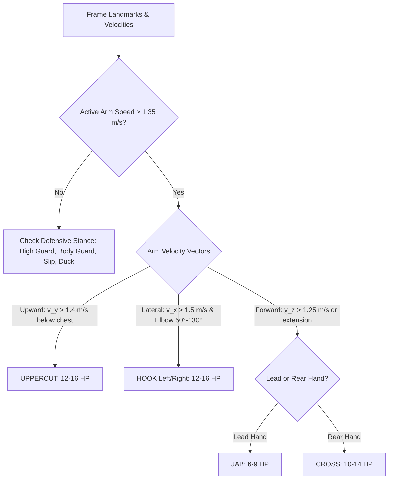
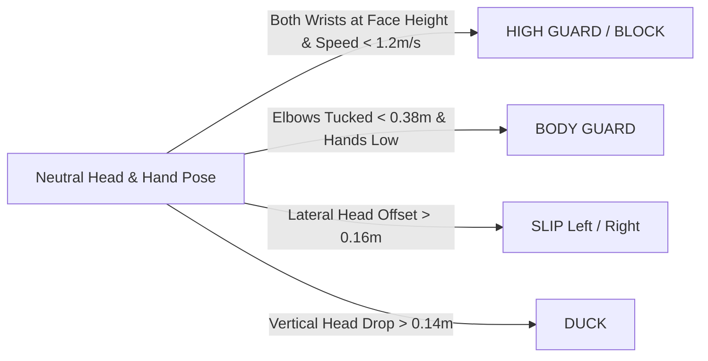
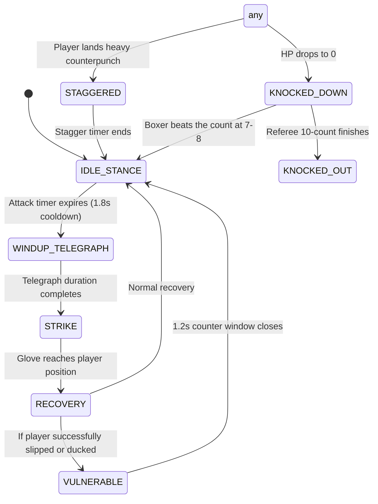

# Arcade Boxing 3D Pro Wiki

**Module Path**: [`src/boxing/BoxingScene.ts`](file:///src/boxing/BoxingScene.ts) | [`src/boxing/PunchClassifier.ts`](file:///src/boxing/PunchClassifier.ts) | [`src/boxing/OpponentBoxerAI.ts`](file:///src/boxing/OpponentBoxerAI.ts)  
**Game Mode ID**: `'boxing'`  
**Governing Standard**: Marquess of Queensberry Combat Rules with Arcade Kinetic Stance & Damage Mechanics  

---

## 1. Executive Summary & Sport Overview

**Arcade Boxing 3D Pro** transforms the player's living room into a high-intensity professional boxing ring. Powered by real-time computer vision, CamArena's biomechanical engine tracks head position, shoulder tilts, elbow angles, and wrist velocities to distinguish jabs, power crosses, hooks, and uppercuts while recognizing authentic defensive guards, ducks, and slips.

### Boxing Fundamentals & CamArena Rules:
- **Round Mechanics**: Matches are contested across scheduled rounds (typically 3 rounds of 60–90 seconds each) or until a Knockout (KO) / Technical Knockout (TKO).
- **Damage & Stamina System**: Both combatants possess 100 Health Points (HP). Heavy punch combinations deplete stamina, temporarily reducing punch velocity and recovery speed.
- **Scoring & Knockdowns**:
  - Landing clean head and body punches scores points.
  - Knocking an opponent's HP to 0 induces a **Knockdown**.
  - A referee begins an official **10-Count**. If the boxer fails to rise before 10, the match ends in a **Knockout (KO)**.
  - Three knockdowns in a single match trigger a **Technical Knockout (TKO)**.

---

## 2. Arena Geometry & Fighter Rigs

Unlike traditional 2D fighting games, CamArena uses a full 3D sports broadcast presentation with a symmetrical X-axis engagement line:

| Dimension | In-Engine Specification | Coordinate / Value |
|---|---|---|
| **Ring Canvas Dimensions** | $6.10\text{ m} \times 6.10\text{ m}$ ($20\text{ ft} \times 20\text{ ft}$) | Centered at $[0, 0, 0]$ |
| **Player Root Position** | Screen Left (Facing $+X$) | $X = +0.46\text{ m}, Y = 0.0, Z = 0.0$ |
| **Opponent Root Position** | Screen Right (Facing $-X$) | $X = -0.46\text{ m}, Y = 0.0, Z = 0.0$ |
| **Torso Separation** | Symmetrical Strike Distance | $0.92\text{ m}$ baseline |
| **Upper Arm Segment Length** | Shoulder $\rightarrow$ Elbow Joint | $0.29\text{ m}$ |
| **Forearm Segment Length** | Elbow $\rightarrow$ Wrist Joint | $0.28\text{ m}$ |
| **Max Anatomical Reach** | Clamped Glove Tip Reach | $0.72\text{ m}$ |

```
                 [SCREEN TOP / BROADCAST CAMERA (Z = -4.65m)]
                                      │
                                      ▼
    ┌─────────────────────────────────────────────────────────────────┐
    │                       BOXING RING CANVAS                        │
    │                                                                 │
    │         [PLAYER 1: BLUE/CYAN]       [IRON TITAN: CRIMSON]       │
    │             Root: (+0.46m)              Root: (-0.46m)          │
    │                   O                          O                  │
    │                  /|\        ◄ 0.92m ►       /|\                 │
    │                  / \                        / \                 │
    │             (Screen Left)              (Screen Right)           │
    │                                                                 │
    └─────────────────────────────────────────────────────────────────┘
```

---

## 3. Biomechanical Punch Classification (`PunchClassifier`)

CamArena tracks 33 MediaPipe Pose landmarks at 60 FPS. Every frame is evaluated for velocity vectors, joint angles, and spatial extensions.



### 1. Offensive Punch Repertoire:

| Punch Type | Primary Velocity Criteria | Biomechanical Signature | Base Damage | Target Hurtbox |
|---|---|---|---|---|
| **Jab** | Forward $\|v_z\| > 1.25\text{ m/s}$ | Lead hand quick linear extension ($>0.28\text{m}$) | $6\text{--}9\text{ HP}$ | Head / Face |
| **Straight Cross** | Forward $\|v_z\| > 1.25\text{ m/s}$ | Rear dominant hand kinetic rotation & thrust | $10\text{--}14\text{ HP}$ | Chin / Head |
| **Left / Right Hook** | Lateral $\|v_x\| > 1.50\text{ m/s}$ | Elbow flexed between $50^\circ$ and $130^\circ$, sweeping arc | $12\text{--}16\text{ HP}$ | Jaw / Temples |
| **Uppercut** | Vertical $\|v_y\| > 1.40\text{ m/s}$ | Wrist starts below chest ($y < y_{\text{shoulder}} - 0.05\text{m}$) | $12\text{--}16\text{ HP}$ | Chin / Solar Plexus |
| **Body Blow** | Any punch with $y < y_{\text{shoulder}} - 0.12\text{m}$ | Low elevation strike into ribs or liver | $12\text{--}16\text{ HP}$ | Body / Liver |

### 2. Kinetic Arm Rig Animation Cycle:
When a punch triggers, the procedural 3D arm rig executes a snappy 4-phase kinetic trajectory:
1. **`GUARD`**: Default athletic defensive posture protecting chest and jaw.
2. **`EXTENDING` ($115\text{ ms}$)**: Forward projection following a Quadratic Bezier arc with an elevated control point ($\vec{P}_{\text{arc}}$) producing authentic boxing loop arcs.
3. **`CONTACT` ($40\text{ ms}$)**: Physical contact hold with micro hit-stop impact freeze.
4. **`RETRACTING` ($110\text{ ms}$)**: Rapid elastic snapback into defensive guard.
- A **$180\text{ ms}$ debounce window** ensures clean separation between rapid multi-punch combos.

---

## 4. Defensive Stances & Evasions

Defensive mastery is essential for high-level play. CamArena continuously analyzes the player's guard and head position:



### Defensive Mechanics:
1. **High Guard (Block)**:
   - **Detection**: Both wrists brought within $0.28\text{ m}$ of each other, held at or above shoulder height ($Y \ge Y_{\text{shoulder}} + 0.05\text{m}$), and stationary ($\text{speed} < 1.2\text{ m/s}$).
   - **Effect**: Absorbs **75% of incoming strike damage**. Triggers a muffled leather glove block sound.
2. **Body Guard**:
   - **Detection**: Elbows tucked tightly against the ribcage ($< 0.38\text{ m}$ separation) with hands shielding abdomen.
   - **Effect**: Absorbs low body blows and liver hooks.
3. **Slips (Head Movement)**:
   - **Detection**: Head lateral displacement relative to shoulder midpoint:
     $$\Delta X_{\text{head}} = X_{\text{nose}} - X_{\text{shoulderCenter}} \quad (|\Delta X| > 0.16\text{ m})$$
   - **Effect**: Completely evades incoming straight jabs and crosses. Triggers an evasive swoosh sound and opens an instant **Counter Window**.
4. **Ducks (Bob and Weave)**:
   - **Detection**: Head vertical displacement drops $> 0.14\text{ m}$ below calibrated neutral height.
   - **Effect**: Evades high hooks and upper blows, slipping cleanly beneath the opponent's gloves.

---

## 5. AI Opponent Boxer: "Iron Titan"

The AI boxer is driven by `OpponentBoxerAI`, featuring a tactical state machine that telegraphs strikes, reacts to player defense, and manages knockdowns:



### AI Features & Attack Telegraphing:
- **Telegraph Flares**: Prior to executing a strike, Iron Titan's attacking glove emits a brilliant neon pulse during the windup phase:
  - **Casual**: $500\text{ ms}$ telegraph window.
  - **Pro**: $420\text{ ms}$ telegraph window.
  - **Champion**: $350\text{ ms}$ telegraph window.
- **Telegraphed Counter Requirements**:
  - *Straight Jab / Cross*: Player must execute a **Slip** or **High Guard**.
  - *Wide Hook*: Player must execute a **Duck**.
  - *Body Blow*: Player must execute a **Body Guard** or step back.
- **Vulnerable Counter Window**: If the player dodges an attack, Iron Titan enters `VULNERABLE` state for $1.2\text{ seconds}$. Any counterpunch landed during this window deals **$1.5\times$ critical damage** and staggers the AI.

---

## 6. Camera System & Impact Juice

CamArena utilizes three distinct broadcast camera perspectives:
1. **Classic Side Cam** (Default):
   - Position: $[0.0, 2.05, -4.65]$, looking at $[0.0, 1.25, 0.0]$.
   - Displays both fighters in profile along the ropes, ensuring full visibility of punch extensions and slips.
2. **Wide Arena Cam**:
   - Position: $[0.0, 3.20, -9.20]$, looking at $[0.0, 1.20, 0.0]$.
   - Stadium perspective capturing the full ring, corner posts, and arena crowd.
3. **Fighter POV Cam**:
   - Position: $[0.40, 1.58, 0.0]$, looking across directly into Iron Titan's eyes.
   - Immersive first-person perspective.

### Visual & Acoustic Polish:
- **Hit Reactions**: Head snap rotation ($\text{Rot}_y, \text{Rot}_z$) and torso twist proportional to strike momentum.
- **Camera Trauma**: Camera shakes violently upon heavy power strikes, decaying quadratically: $\text{Trauma} = \max(0, \text{Trauma} - 3.2 \times \Delta t)$.
- **Dynamic HUD**: Dual health bars, stamina meters, punch speed gauge (displaying real-time km/h and m/s), and real-time defensive stance callouts (`HIGH GUARD`, `SLIPPING RIGHT`, `DUCKING`).

---

## 7. Controls & Keyboard Shortcuts

| Control | Input | In-Game Action |
|---|---|---|
| **Webcam Motion** | Real Boxing Punches | Throws Jabs, Crosses, Hooks, Uppercuts |
| **Webcam Motion** | High Hands / Tucked Elbows | High Guard (Block) / Body Guard |
| **Webcam Motion** | Lateral Lean / Knee Bend | Slips Left/Right / Ducks below hooks |
| **`C`** | Cycle Camera View | Toggles Classic Side, Wide Arena, and Fighter POV |
| **`1` / `2`** | Synthetic Punch Testing | Fires left jab (`1`) or right power cross (`2`) |
| **`3` / `4`** | Synthetic Hook Testing | Fires left hook (`3`) or right hook (`4`) |
| **`5` / `6`** | Synthetic Uppercut Testing | Fires left uppercut (`5`) or right uppercut (`6`) |
| **`B` / `S` / `D`** | Synthetic Defense Testing | Triggers Block (`B`), Slip (`S`), or Duck (`D`) |

