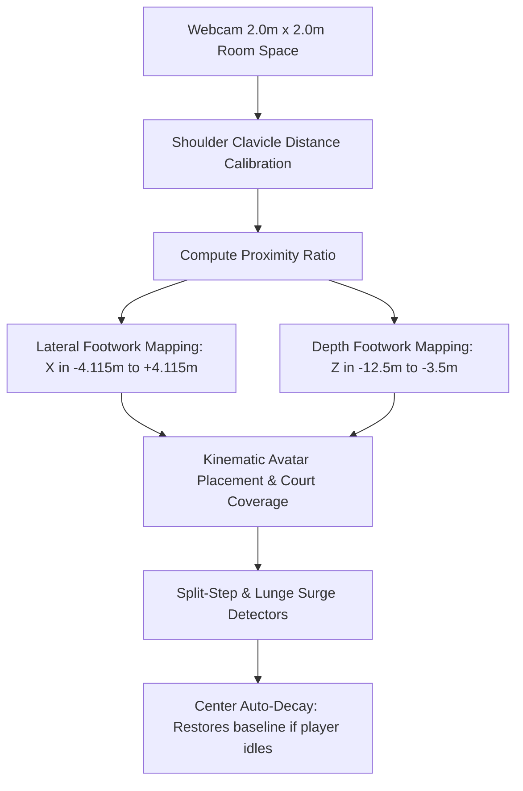
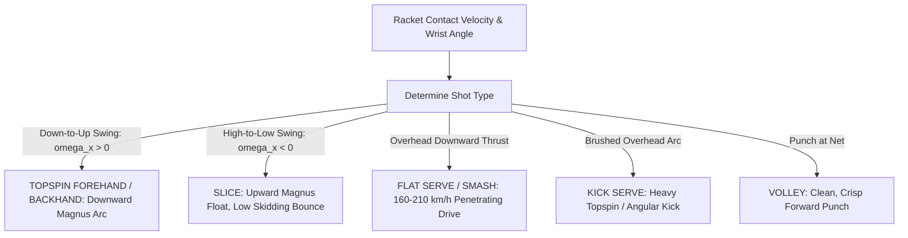
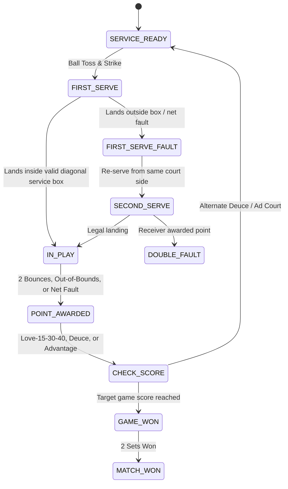

# Lawn Tennis 3D Pro Wiki

**Module Path**: [`src/tennis/TennisScene.ts`](file:///src/tennis/TennisScene.ts) | [`src/tennis/TennisPhysics.ts`](file:///src/tennis/TennisPhysics.ts) | [`src/tennis/TennisRules.ts`](file:///src/tennis/TennisRules.ts) | [`src/tennis/TennisAI.ts`](file:///src/tennis/TennisAI.ts) | [`src/tennis/TennisSpatialTracker.ts`](file:///src/tennis/TennisSpatialTracker.ts)  
**Game Mode ID**: `'tennis'`  
**Governing Standard**: International Tennis Federation (ITF) Official Rules of Tennis  

---

## 1. Executive Summary & Sport Overview

**Lawn Tennis 3D Pro** brings Grand Slam tennis into the player's home using advanced markerless body tracking. By integrating a dedicated **Living-Room Spatial Footwork Tracker**, a **120 Hz aerodynamic physics engine** with real-world drag and Magnus lift coefficients, an official **ITF tournament scoring engine**, and a **tactical rally-pacing AI opponent**, CamArena captures the full strategic and athletic depth of professional tennis.

### ITF Rules of Tennis Fundamentals:
- **Scoring Progression**: Points progress from **Love ($0$)** $\rightarrow$ **$15$** $\rightarrow$ **$30$** $\rightarrow$ **$40$** $\rightarrow$ **Game**.
- **Deuce & Advantage**: At $40\text{--}40$ (**Deuce**), a player must win two consecutive points:
  - **Advantage In (Ad-In)**: Server leads by 1 point.
  - **Advantage Out (Ad-Out)**: Receiver leads by 1 point.
- **Service Court Rotation**:
  - The first point of each game is served from behind the baseline on the **Deuce Court** (right side) diagonally into the receiver's deuce service box.
  - Subsequent points alternate between the **Ad Court** (left side) and Deuce Court.
- **Faults & Double Faults**:
  - Missing the service box on the first delivery triggers a **First Serve Fault**.
  - A second consecutive fault results in a **Double Fault**, awarding the point to the receiver.
- **One-Bounce Rule**: Once in play, the ball must be struck after no more than **one bounce** on the player's side, or out of the air as a **Volley** (provided the player does not touch the net).

---

## 2. Court Geometry & Dimensions

The virtual court is built to exact International Tennis Federation (ITF) hardcourt regulations:

| Dimension | ITF Official Standard | CamArena In-Engine Metric | Engine Constant |
|---|---|---|---|
| **Court Length** | $23.77\text{ m}$ ($78\text{ ft}$) | $23.77\text{ m}$ ($Z = -11.89$ to $+11.89$) | Full Baseline Bounds |
| **Singles Court Width** | $8.23\text{ m}$ ($27\text{ ft}$) | $8.23\text{ m}$ ($X = -4.115$ to $+4.115$) | `COURT_HALF_WIDTH = 4.115` |
| **Doubles Alley Width** | $1.37\text{ m}$ each side ($10.97\text{m}$ total) | $1.37\text{ m}$ ($X = \pm 4.115$ to $\pm 5.485$) | Rendered with white tramlines |
| **Net Height (Center)** | $0.914\text{ m}$ ($3.0\text{ ft}$) | $0.914\text{ m}$ at center strap ($Z = 0.0$) | Modeled catenary net curve |
| **Net Height (Posts)** | $1.07\text{ m}$ ($3.5\text{ ft}$) | $1.07\text{ m}$ at singles post sticks | Modeled post height |
| **Service Line Distance** | $6.40\text{ m}$ from net ($21\text{ ft}$) | $Z = \pm 6.40\text{ m}$ | `serviceLineDist = 6.40` |
| **Player Baseline** | Tactical player stance | $Z = -11.50\text{ m}$ | `BASELINE_Z = -11.5` |
| **Deep Defense Zone** | Rear baseline boundary | $Z = -12.50\text{ m}$ | `DEEP_DEFENSE_Z = -12.5` |
| **Volley Net Zone** | Front approach boundary | $Z = -3.50\text{ m}$ | `VOLLEY_ZONE_Z = -3.5` |

```
                       [OPPONENT BASELINE: Z = +11.89m]
                         AI Avatar: Z = +11.50m
    ┌──────────┬───────────────────────┬───────────────────────┬──────────┐
    │          │                       │                       │          │
    │          │  Far Left Backcourt   │  Far Right Backcourt  │          │
    │  Doubles │                       │                       │  Doubles │
    │   Tram   ├───────────────────────┼───────────────────────┤   Tram   │  ◄ Far Service Line (Z = +6.40m)
    │   Line   │ Far Ad Service Box    │ Far Deuce Service Box │   Line   │
    ╞══════════╪═══════════════════════╪═══════════════════════╪══════════╡  ◄ NET (Z = 0.0m, Height = 0.914m)
    │   Tram   │ Near Deuce Service Box│ Near Ad Service Box   │   Tram   │
    │   Line   ├───────────────────────┼───────────────────────┤   Line   │  ◄ Near Service Line (Z = -6.40m)
    │          │                       │                       │          │
    │          │  Near Right Backcourt │  Near Left Backcourt  │          │
    │          │                       │                       │          │
    └──────────┴───────────────────────┴───────────────────────┴──────────┘
                        [PLAYER BASELINE: Z = -11.50m]
                                      ▲
                                Player Avatar
```

---

## 3. Living-Room Spatial Footwork Tracker (`TennisSpatialTracker`)

A major technical challenge in motion-controlled tennis is that players cannot sprint across a full $23.77\text{ m}$ court in an apartment living room. CamArena solves this with the **Adaptive Living-Room Spatial Tracker**:



### Spatial Mapping Algorithms:
1. **Lateral Proportional Scaling**:
   The player's physical lateral steps across a $2.0\text{ m}$ room footprint are normalized and mapped smoothly across the $8.23\text{ m}$ singles court width:
   $$X_{\text{court}} = \text{clamp}(X_{\text{torso,normalized}} \times 4.115\text{ m}, -4.115, +4.115)$$
2. **Dynamic Depth & Proximity Scaling**:
   The distance between clavicle/shoulder landmarks calibrated at startup indicates player depth relative to the webcam:
   $$\text{ProximityRatio} = \frac{\text{CurrentShoulderSpan}}{\text{BaselineShoulderSpan}}$$
   - Stepping forward towards the camera scales the avatar smoothly from the baseline ($Z = -11.5\text{ m}$) into the service line ($Z = -6.4\text{ m}$) and volley attack zone ($Z = -3.5\text{ m}$).
   - Stepping backward moves the avatar into deep baseline defense ($Z = -12.5\text{ m}$).
3. **Split-Step & Lunge Boosts**:
   - Rapid upward/downward hip micro-drops trigger a **Split-Step**, granting a momentary acceleration boost to intercept sharp cross-court angles.
   - Rapid lateral foot extension triggers a **Lunge**, extending racket reach by up to $0.85\text{ m}$.
4. **Tactical Center Auto-Decay**:
   If the player comes to rest (velocity $< 0.15\text{ m/s}$) for more than $1.2\text{ seconds}$, the avatar smoothly glides back toward the tactical center of the court ($X = 0, Z = -11.5$), matching real-world tennis footwork recovery without forcing the player to physically walk backwards.

---

## 4. Aerodynamic Simulation & 120 Hz Physics Engine (`TennisPhysics`)

Tennis balls travel at high velocity with pronounced aerodynamic drag and spin. To prevent frame-rate dependency, `TennisPhysics` evaluates equations of motion at a fixed **120 Hz sub-tick** ($\Delta t = 0.00833\text{ s}$):

### Physical Constants:
- **Ball Mass ($m$)**: $0.058\text{ kg}$ ($58\text{ g}$, ITF regulation $56.0\text{--}59.4\text{ g}$)
- **Ball Radius ($R$)**: $0.033\text{ m}$ (visual radius $0.065\text{ m}$ with high-visibility optic-yellow felt and white curved rubber seams)
- **Air Density ($\rho$)**: $1.21\text{ kg/m}^3$ (standard sea-level atmospheric density)
- **Drag Coefficient ($C_d$)**: $0.55$ (characteristic fuzzy tennis ball drag)
- **Magnus Lift Coefficient ($C_l$)**: $0.32$
- **Hardcourt Restitution ($e_y$)**: $0.72$ (vertical bounce velocity retention)
- **Ground Friction ($\mu$)**: $0.38$ (tangential deceleration upon bounce)

### Equations of Motion:
$$\vec{F}_{\text{gravity}} = m \begin{bmatrix} 0 \\ -9.81 \\ 0 \end{bmatrix}$$
$$\vec{F}_{\text{drag}} = -\frac{1}{2}\rho C_d (\pi R^2) \|\vec{v}\|\vec{v}$$
$$\vec{F}_{\text{Magnus}} = \frac{1}{2}\rho C_l (\pi R^2) \left(\frac{\vec{\omega} \times \vec{v}}{\|\vec{\omega}\|}\right)$$
$$\vec{a}(t) = \frac{\vec{F}_{\text{gravity}} + \vec{F}_{\text{drag}} + \vec{F}_{\text{Magnus}}}{m}$$



### Complete Shot Repertoire:

| Shot Type | Speed Range | Spin Vector ($\vec{\omega}$) | Flight Characteristics & Bounce Dynamics |
|---|---|---|---|
| **Flat Serve** | $160\text{--}210\text{ km/h}$ | Low ($\approx 10\text{ rad/s}$) | Bullet trajectory skimming net, fast low bounce |
| **Kick Serve** | $130\text{--}160\text{ km/h}$ | Heavy Topspin/Sidespin | Arcs high over net, bites hardcourt, kicking diagonally |
| **Topspin Forehand** | $100\text{--}140\text{ km/h}$ | Heavy Topspin ($+45\text{ rad/s}$) | Steep downward curl inside baseline, fast forward kick |
| **Topspin Backhand** | $95\text{--}130\text{ km/h}$ | Heavy Topspin ($+40\text{ rad/s}$) | Sharp dipping angle ideal for cross-court passing shots |
| **Slice / Backspin** | $70\text{--}100\text{ km/h}$ | Backspin ($-35\text{ rad/s}$) | Floats gracefully, checks forward speed, stays low |
| **Volley** | $60\text{--}90\text{ km/h}$ | Neutral / Slight Under | Intercepted in air before bounce; short reaction time |
| **Smash** | $130\text{--}180\text{ km/h}$ | Downward Impulse | Over-the-head kill shot against defensive lobs |
| **Defensive Lob** | $50\text{--}70\text{ km/h}$ | High Arc Backspin | High trajectory clearing opponent at net, resets position |

---

## 5. ITF Rule Engine & Service Box Verification (`TennisRules`)

The rules engine handles full tournament match scoring, game-set-match transitions, and service court rotation:



### Diagonal Service Box Mathematical Check:
When Player 1 serves into the far court ($Z > 0$):
- **Deuce Service (from right side $X > 0$)**: Must land between net ($Z=0$) and far service line ($Z=6.40\text{ m}$), with lateral coordinates in receiver's deuce court: $X \in [-4.115, 0.0]$.
- **Ad Service (from left side $X < 0$)**: Must land between net and far service line, with lateral coordinates in receiver's ad court: $X \in [0.0, +4.115]$.
- Any landing outside these boundaries or failure to clear the net ($Y < 0.914\text{ m}$) is flagged as a fault.

---

## 6. AI Opponent & Rally Pacing Engine (`TennisAI`)

The AI opponent is animated via `Avatar3D` on the far court, wielding regulation tennis equipment.

### The Rally Pacing Engine:
In many video games, AI either makes instant mistakes or fires unreachable winners immediately. CamArena incorporates an authentic **Rally Pacing Engine**:
- **Sustained Rallies**: AI is programmed to intentionally sustain rallies for **$6\text{ to }12\text{ consecutive shots}$**, trading cross-court drives and baseline topspins.
- **Winner Opportunities**: Only after a rally reaches its target threshold (or if the player delivers a weak, short return with depth $Z > -6.0\text{ m}$) does the AI unleash an aggressive down-the-line winner or acute cross-court angle.
- **Difficulty Scaling**:
  - **Casual**: Wider strike margin ($0.95\text{ m}$ reach), slower footwork recovery, predictable baseline drives.
  - **Pro**: Aggressive top-spin drives, quick split-step reactions, dynamic serve variations (flat vs kick).
  - **Legend**: Relentless deep baseline targeting, deceptive drop shots, and aggressive net rush volleys.

---

## 7. Camera Systems & Atmosphere

1. **Camera Presets**:
   - `broadcast` (Default): High elevated center-court stadium broadcast camera ($X=0, Y=4.8, Z=-17.2$) looking down across the full court ($Y=1.2, Z=2.0$).
   - `over_shoulder`: Dynamic behind-the-back third-person camera ($X=1.2, Y=2.2, Z=-13.8$) following player strokes.
   - `court_level`: Immersive ground-level view capturing full ball speed and net height perspective.
2. **Procedural Web Audio**:
   - Resonant composite acoustic string vibrations for racket sweet spots vs frames.
   - Ball hardcourt bounce thump with dynamic pitch shifting based on impact velocity.
   - Dynamic crowd applauding long rallies and umpire line-call announcements (`Fault!`, `Out!`, `Let!`, `Deuce!`, `Advantage!`).

---

## 8. Controls & Keyboard Shortcuts

| Input Mode | Action | In-Game Mechanics |
|---|---|---|
| **Webcam Motion** | Natural Racket Swing | Forehands, backhands, overhead smashes, and slices |
| **Webcam Motion** | Lateral Steps & Depth | Physical movement across living room mapped to court |
| **Webcam Motion** | Support Hand Up | Tosses the ball into the air to initiate service |
| **Keyboard** | `Arrow Keys` / `WASD` | Fine-tuning footwork positioning ($\pm 0.55\text{ m}$) |
| **Keyboard** | `Spacebar` / Click | Triggers serve toss or swing stroke fallback |
| **Keyboard** | `C` | Cycle camera views (Broadcast, Over-Shoulder, Court-Level) |
| **Keyboard** | `Esc` / `P` | Pause / Resume match |

